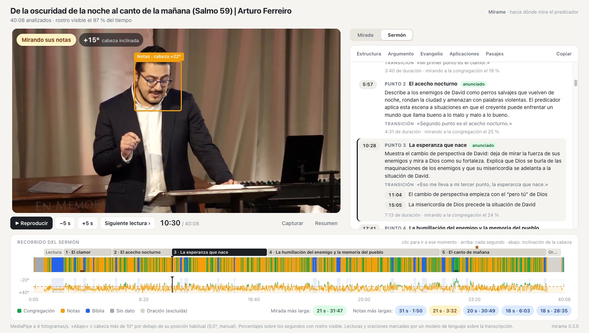
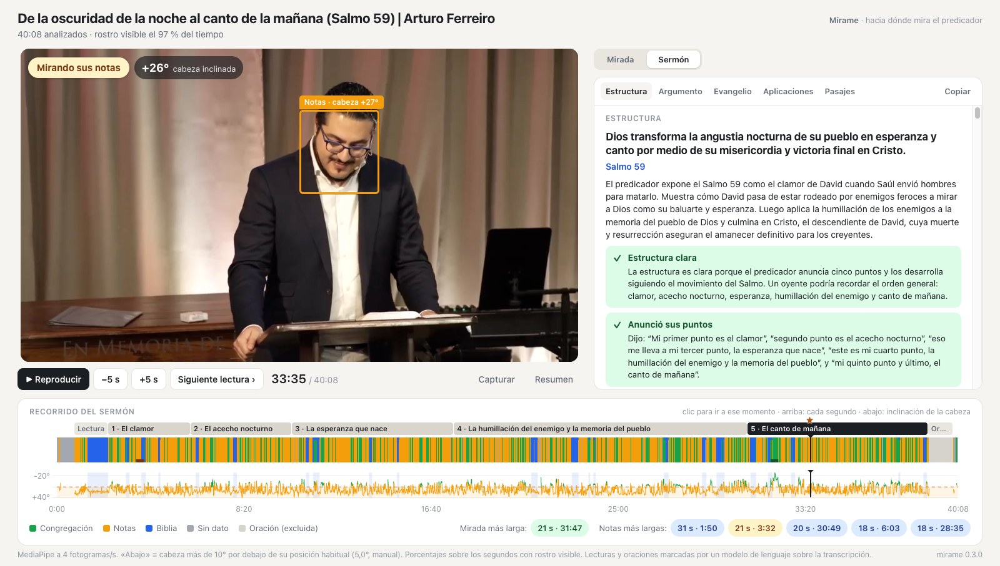
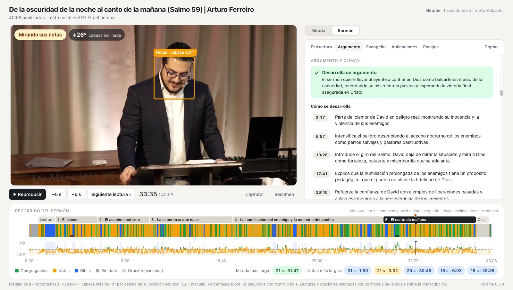
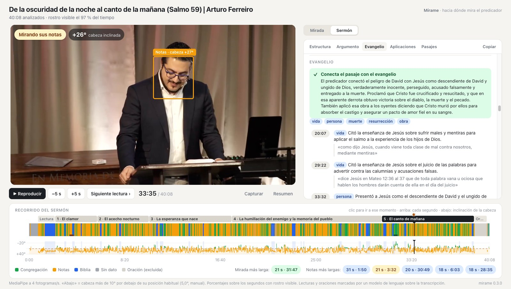
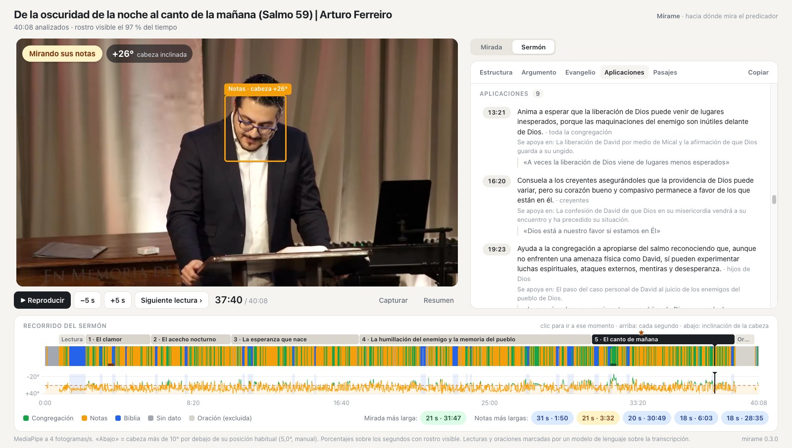

# Mírame

**¿Hacia dónde mira el predicador, y hacia dónde apunta su sermón?** Mírame toma el video de un sermón y responde las dos preguntas:

- **Hacia dónde mira el predicador.** Segundo a segundo, cuánto tiempo mira a la congregación y cuánto baja la vista a sus notas. Corre en tu computadora, sin cuentas ni suscripciones.
- **Hacia dónde apunta el sermón** (opcional, con una clave de IA). La estructura y sus transiciones, el argumento y el clímax, cómo se conectó el pasaje con el evangelio de Cristo, las aplicaciones a la congregación y los pasajes bíblicos citados. Cada cosa con su minuto y segundo, para ir a ese momento del video con un clic.

<p>
  
  
</p>

*A la izquierda, el predicador baja la vista a sus notas (recuadro naranja). A la derecha, mira a la congregación (recuadro verde).*

<p>
  
</p>

*La pestaña «Sermón»: las partes del sermón con el minuto y las palabras de cada transición, y cuánto miró el predicador a la congregación en cada una. Sobre la línea de tiempo, la franja de los puntos y una estrella en el clímax.*

Lo hice porque quería mejorar como predicador y me di cuenta de que, si no medía, solo iba a seguir suponiendo. No encontré una herramienta que contara cuántas veces uno baja la mirada al predicar, así que la construí con ayuda de un modelo de IA. Es de código abierto: úsala, compártela y mejórala.

— Jacobis Aldana

**Sobre esta versión.** Es un fork del [proyecto original](https://github.com/jacomv/mirame) de Jacobis Aldana que añade el análisis del contenido del sermón.

Al predicar no solo importa el contacto visual con la congregación. Importa también el contenido del mensaje: si tiene una buena estructura, si apunta a conocer y entender más al Señor Jesucristo y si lleva a una buena aplicación para la iglesia. Por eso me pareció bueno reunir los dos análisis en una sola herramienta. El nombre sigue diciendo lo que hace, ahora en dos sentidos: hacia dónde mira el predicador y hacia dónde apunta su sermón.

Este añadido nace de un grupo de predicación expositiva en la Iglesia Evangélica Cuajimalpa, donde los varones de la iglesia nos preparamos para predicar la Palabra con fidelidad y expositivamente. La idea es ir afinando el análisis, quizá con un método claro como el de Simeon Trust.

— Arturo Ferreiro

---

## Qué te dice

### Sobre la mirada

- **Qué porcentaje del sermón** miraste a la congregación, cuánto a tus notas y cuánto a la Biblia.
- **Cuánto dura cada mirada** a la gente en promedio, y cuál fue la más larga.
- **Cuántas veces bajaste a las notas** y cuál fue la lectura más larga.
- **Un reporte** con el video del sermón y, al lado, una línea de tiempo que se pinta de verde (congregación), naranja (notas) o azul (Biblia). Un clic en cualquier punto lleva el video a ese momento.
- **Capturas PNG** de 1920×1080 listas para un artículo o una presentación.

### Sobre el sermón (opcional, con IA)

- **La estructura:** las partes del sermón, el minuto y las palabras de cada transición, si la estructura es clara y si el predicador anunció sus puntos, con el minuto de cada anuncio.
- **La introducción:** si prepara el argumento principal o habla de otra cosa.
- **El argumento y el clímax:** la tesis, los pasos con que se desarrolla y dónde está el clímax.
- **El evangelio:** cómo se conectó el pasaje con el evangelio de Cristo y qué aspecto se mencionó (su vida, su muerte, su resurrección, su obra, su segunda venida, su reinado).
- **Las aplicaciones** a la congregación: a quién van dirigidas y en qué se apoyan.
- **Los pasajes bíblicos** leídos, citados o aludidos.
- **Las dos cosas juntas:** cuánto miró a la congregación en cada parte del sermón.

Todo va con su minuto y segundo en la pestaña «Sermón» del reporte: un clic lleva el video a ese momento, y el análisis completo se copia como texto.

## Cómo lo mide

1. Revisa el video **cuatro veces por segundo**. En cada cuadro ubica el rostro del predicador con [MediaPipe](https://ai.google.dev/edge/mediapipe/solutions/vision/face_landmarker) y mide dos cosas: cuánto inclina la cabeza y hacia dónde apuntan los ojos. Se puede leer con la cabeza recta, moviendo solo la mirada, y eso también cuenta.
2. Aprende la **postura habitual** del predicador cuando mira a la gente (la mediana del sermón). Marca como «abajo» lo que pasa de 15° por debajo de esa postura, o cuando los ojos se bajan aunque la cabeza no se mueva.
3. Agrupa por segundo y calcula los porcentajes, las miradas y los episodios de lectura.
4. **Opcional, con IA:** transcribe el audio y un modelo de lenguaje marca dónde se lee la Biblia y dónde se ora. Así, leer el texto bíblico no cuenta igual que leer el manuscrito, y cerrar los ojos al orar no se confunde con mirar abajo.
5. **Opcional, con IA:** sobre esa misma transcripción, un modelo de lenguaje analiza la estructura y el contenido del sermón (ver abajo).

## Cómo analiza el sermón

Es opcional y necesita una clave de IA. Trabaja sobre la transcripción, no sobre el video:

1. **Transcribe el audio** con Whisper. Cada frase queda numerada, con su segundo de inicio y de fin.
2. **Hace tres consultas a un modelo de lenguaje**, con las frases numeradas:
   - *Estructura, argumento y clímax*, con el sermón completo.
   - *Evangelio y aplicaciones*, con el sermón completo.
   - *Pasajes citados*, en ventanas de 8 minutos para no dejar ninguno. La misma referencia repetida en menos de 45 segundos cuenta una vez.
3. **El modelo no da minutos.** Señala el número de la frase, y el tiempo sale de la transcripción. Así cada minuto del reporte corresponde a algo que se dijo. Lo que apunta a una frase que no existe se descarta.
4. **Describe, no completa.** Se le pide registrar solo lo que el predicador dijo, con citas literales, y no lo que un buen sermón debería tener. Un punto figura como «anunciado» solo si se dijo en voz alta, y las menciones de paso a Cristo («en el nombre de Jesús» al orar) no cuentan como evangelio.
5. **Cruza el resultado con la mirada.** En cada parte del sermón dice qué porcentaje del tiempo el predicador miró a la congregación. Las cifras de la mirada no cambian.

El resultado queda en `estructura.json` (lo que muestra la pestaña «Sermón»; se puede corregir a mano) y en `estructura.md` (lo mismo, como texto). Los modelos que se usan están en [Claves de IA](#claves-de-ia-opcional).

Conviene leerlo como la opinión de un oyente atento, no como un veredicto. Es el juicio de un modelo de lenguaje sobre una transcripción automática: no oye el tono ni las pausas, puede dividir el sermón distinto a como lo pensó el predicador, y dos corridas pueden mover una transición una o dos frases.

El detalle del método, sus límites y cómo validarlo están en [docs/como-funciona.md](docs/como-funciona.md). Un ejemplo de lo que cuesta la IA con OpenAI está en [docs/costos-openai.md](docs/costos-openai.md).

**Tu video no sale de tu computadora.** Todo el análisis de imagen es local. Si activas la IA, lo único que se envía es el audio (al servicio de transcripción) y el texto transcrito (al modelo que marca las lecturas y analiza la estructura).

---

## Instalación

Necesitas dos programas: **uv**, que instala Mírame y su versión de Python, y **ffmpeg**, que lee y recorta el video. Se instalan una sola vez.

### macOS

Abre la app **Terminal** y pega, una por una:

```bash
# 1. Homebrew (si no lo tienes): https://brew.sh
/bin/bash -c "$(curl -fsSL https://raw.githubusercontent.com/Homebrew/install/HEAD/install.sh)"

# 2. ffmpeg y uv
brew install ffmpeg uv

# 3. Mírame
uv tool install "mirame[capturas] @ git+https://github.com/jacomv/mirame"
mirame instalar-capturas
```

### Windows

Abre **PowerShell** y pega, una por una:

```powershell
winget install --id Gyan.FFmpeg
winget install --id astral-sh.uv
# Cierra y vuelve a abrir PowerShell para que reconozca los comandos nuevos.
uv tool install "mirame[capturas] @ git+https://github.com/jacomv/mirame"
mirame instalar-capturas
```

### Linux (Debian, Ubuntu)

```bash
sudo apt install ffmpeg
curl -LsSf https://astral.sh/uv/install.sh | sh
uv tool install "mirame[capturas] @ git+https://github.com/jacomv/mirame"
mirame instalar-capturas
```

`mirame instalar-capturas` descarga el navegador que usa el botón **Capturar** (unos 150 MB). Si no te interesan las capturas, instala sin `[capturas]` y omite ese paso: lo demás funciona igual.

La primera vez que analices un sermón, Mírame descarga el modelo de MediaPipe (3,6 MB).

### Actualizar o desinstalar

```bash
uv tool upgrade mirame        # actualizar
uv tool uninstall mirame      # desinstalar (tus análisis quedan en ~/Mirame)
```

---

## Uso

### La app

```bash
mirame
```

Se abre en tu navegador, en `http://127.0.0.1:8710`. Solo tu computadora puede verla. Para cerrarla, vuelve a la terminal y presiona `Ctrl+C`.


**Nuevo análisis.** Pega el enlace de YouTube o elige un video de tu computadora. Con una clave de IA puedes marcar además «Separar la lectura bíblica y la oración» y «Analizar la estructura del sermón». Si el video incluye alabanza o anuncios, escribe dónde empieza y dónde termina la predicación (`mm:ss` o `h:mm:ss`), porque solo así el resultado describe el sermón. En un Mac mini con chip de Apple, un sermón de una hora tarda unos 3 minutos; en una computadora más lenta tarda más.

**Biblioteca.** Los análisis guardados, con sus cifras principales. Desde aquí abres el reporte, separas la lectura bíblica o analizas la estructura de un análisis que ya tienes, o lo borras. Abajo puedes vaciar la caché de videos descargados para liberar espacio; tus análisis no se tocan.

**Ajustes.** Las claves de IA. Son opcionales (ver abajo).

**En el reporte:** espacio reproduce y pausa, ← y → saltan 5 segundos, `R` cambia a la vista de resumen sin video. **Capturar** guarda un PNG del momento actual en la carpeta `capturas/` del análisis.

**La pestaña «Sermón»** aparece junto a «Mirada» cuando el sermón tiene su estructura analizada (tecla `S`). Muestra, al lado del video:

- **Estructura:** el tema, si la estructura es clara, si anunció sus puntos, si la introducción va acorde con el argumento principal, y cada parte con el minuto de su transición, las palabras con que la hizo y cuánto miró a la congregación en esa parte.
- **Argumento y clímax:** la tesis, los pasos del argumento en orden y el momento más alto del sermón.
- **Evangelio:** cómo se conectó el pasaje con Cristo y qué aspectos se mencionaron (su vida, su muerte, su resurrección, su reinado, su segunda venida…).
- **Aplicaciones:** cada llamado a los oyentes, a quién va dirigido y en qué parte del pasaje se apoya.
- **Pasajes citados:** cada referencia bíblica, leída, citada de memoria, mencionada o aludida.

Un clic en cualquier minuto lleva el video a ese momento y lo reproduce. Sobre la línea de tiempo aparece una franja con las partes del sermón y una estrella en el clímax. **Copiar** deja el análisis completo en el portapapeles como texto.

<p>
  
  
</p>
<p>
  
  
</p>
<p>
  
</p>

*De izquierda a derecha y de arriba abajo: el resumen de la estructura, el argumento, el evangelio, las aplicaciones y los pasajes citados.*

### Claves de IA (opcional)

Sin claves, Mírame mide la mirada igual. Con una clave transcribe el sermón y, sobre la transcripción, hace dos cosas:

- **Separa la lectura bíblica y la oración.** El resultado es más preciso porque leer la Biblia en voz alta deja de contar como leer notas, y orar con los ojos cerrados deja de contar como mirar abajo.
- **Analiza la estructura del sermón** (la pestaña «Sermón» del reporte). No cambia las cifras de la mirada.

Basta **una** clave, y se pega en **Ajustes**:

- **Groq**, que es gratis: créala en [console.groq.com/keys](https://console.groq.com/keys). Transcribe con Whisper y analiza el texto con `openai/gpt-oss-120b`. La capa gratuita tiene un límite de 8000 tokens por minuto: en un sermón de 35 minutos alcanzó para transcribir y marcar las lecturas, pero no para analizar la estructura. Con el plan de pago de Groq, el análisis completo de ese sermón costó unos 4,5 centavos de dólar (ver [docs/costos-groq.md](docs/costos-groq.md)).
- **OpenAI**, que es de pago: créala en [platform.openai.com/api-keys](https://platform.openai.com/api-keys). Transcribe con `whisper-1`, marca las lecturas con `gpt-5.4` y analiza la estructura con `gpt-5.5`.

Si pones las dos, Groq transcribe y OpenAI analiza el texto. La pestaña «Sermón» sale mejor con los modelos de OpenAI: al comparar el mismo sermón, el modelo de Groq lo dividió en menos partes y no registró aplicaciones (ver [docs/costos-groq.md](docs/costos-groq.md)). Para que una sola haga todo, elige **Solo OpenAI** o **Solo Groq** en Ajustes, en «Qué API usar». Es el campo `api` de `configuracion.json`: `"openai"`, `"groq"` o vacío para lo automático.

**Cuánto cuesta con OpenAI.** Como ejemplo, un sermón de 35 minutos con todo activado costó 0,98 USD en noviembre de 2026: 0,21 la transcripción, 0,04 marcar las lecturas y la oración, y 0,73 la estructura del sermón. Casi todo crece con los minutos, así que recortar solo la predicación también ahorra. El desglose y cómo gastar menos están en [docs/costos-openai.md](docs/costos-openai.md), y la comparación con Groq en [docs/costos-groq.md](docs/costos-groq.md).

Si prefieres otro modelo de lenguaje, en Ajustes elige **Otro proveedor compatible con OpenAI** y escribe la URL base, la clave y el modelo. Sirve cualquier API con el formato de OpenAI: OpenRouter, Azure, DeepSeek, un LiteLLM propio u Ollama en tu máquina. Para la estructura conviene un modelo capaz, que pueda leer el sermón completo de una vez. La transcripción sigue usando Groq u OpenAI.

Las claves se guardan en `~/Mirame/configuracion.json`, con permisos de lectura solo para tu usuario. También puedes darlas como variables de entorno, que tienen prioridad sobre el archivo:

| Variable | Para qué |
|---|---|
| `GROQ_API_KEY` | Transcripción y, si no hay otro, el modelo de lenguaje |
| `OPENAI_API_KEY` | Modelo de lenguaje y, si no hay clave de Groq, la transcripción |
| `MIRAME_OPENAI_MODELO` | Otro modelo de OpenAI para las lecturas y la estructura |
| `MIRAME_API` | `groq` u `openai`: usar solo esa API para transcribir y analizar, aunque haya otras claves. Vacío = automático |
| `MIRAME_LLM_URL`, `MIRAME_LLM_KEY`, `MIRAME_LLM_MODELO` | Otro modelo compatible con OpenAI para las lecturas y la estructura (URL terminada en `/v1`) |
| `MIRAME_WHISPER_MODELO` | Otro modelo de Whisper en Groq (por defecto `whisper-large-v3-turbo`) |
| `MIRAME_DATOS` | Otra carpeta de datos en lugar de `~/Mirame` |

### Desde la terminal

Todo lo que hace la app también se puede hacer con comandos. Donde dice `<análisis>` va el id que muestra `mirame lista` o la ruta de su carpeta.

```bash
# Analizar solo la predicación (de 32:10 a 1:18:40)
mirame analizar "https://www.youtube.com/watch?v=XXXX" --inicio 32:10 --fin 1:18:40

# Ver los análisis guardados y abrir uno
mirame lista
mirame ver <análisis>

# Separar la lectura bíblica y la oración (requiere clave de IA)
mirame lecturas <análisis>

# Estructura del sermón: partes, argumento, evangelio, aplicaciones y pasajes (requiere clave de IA)
mirame estructura <análisis>
mirame estructura <análisis> --mostrar               # verla otra vez sin consultar a la IA

# Capturas PNG: cuatro momentos elegidos solos, o los que digas
mirame capturar <análisis>
mirame capturar <análisis> --en 19:32 --en 41:45 --resumen

# Ajustar sin volver a procesar el video
mirame recalcular <análisis> --umbral 18             # más o menos estricto con la cabeza
mirame recalcular <análisis> --calibrar 0:00-3:00    # postura habitual tomada de esos minutos
mirame recalcular <análisis> --excluir 5:10-6:40     # dejar fuera un tramo

# Revisar a ojo: 20 fotogramas al azar de cada clase, con el ángulo dibujado
mirame muestras <análisis>

# Comparar con un etiquetado tuyo, segundo a segundo
mirame validar <análisis> etiquetas.csv

mirame borrar <análisis>
mirame --help                                         # todas las opciones
```

---

## Dónde quedan tus datos

Todo vive en `~/Mirame` (en Windows, `C:\Users\<tu usuario>\Mirame`):

```
~/Mirame/
├── analisis/<fecha>_<id>/
│   ├── reporte.html          el reporte; se abre sin conexión y se puede compartir
│   ├── video.mp4             el sermón recortado
│   ├── resumen.json          las cifras del análisis
│   ├── segundos.csv          una fila por segundo: clase, inclinación, ojos
│   ├── fotogramas.csv        una fila por fotograma (4 por segundo)
│   ├── transcripcion.json    si usaste IA: frases con su tiempo
│   ├── lecturas.json         si usaste IA: tramos de lectura bíblica y oración (editable)
│   ├── estructura.json       si usaste IA: la estructura y el contenido del sermón (editable)
│   ├── estructura.md         lo mismo, como texto para leer o compartir
│   └── capturas/             los PNG
├── descargas/                caché de videos completos de YouTube
├── modelos/                  modelo de MediaPipe
└── configuracion.json        claves de IA
```

Si la IA marcó mal una lectura, puedes corregir `lecturas.json` a mano y aplicar el cambio con `mirame lecturas <análisis> --solo-recalcular`. Lo mismo con `estructura.json`: corrígelo y regenera el reporte con `mirame reporte <análisis>`.

---

## Problemas comunes

**«No encuentro ffmpeg».** Instálalo (ver Instalación) y vuelve a abrir la terminal.

**YouTube no deja descargar** («Sign in to confirm you're not a bot» o un error 403). YouTube cambia seguido. Actualiza con `uv tool upgrade mirame`. Si sigue fallando, instala [Deno](https://deno.com), que yt-dlp usa para algunos videos, o descarga el video por tu cuenta y elígelo como archivo en la app.

**«Sin dato» en buena parte del sermón.** La cámara no muestra la cara del predicador (planos lejanos, la congregación, diapositivas). Esos segundos no cuentan en los porcentajes. Si pasan del 30 %, el reporte avisa que el resultado es poco confiable.

**Las capturas no funcionan.** Corre `mirame instalar-capturas`. Si instalaste sin `[capturas]`, reinstala con el comando de la sección de instalación.

**El puerto 8710 está ocupado.** Mírame prueba solo los siguientes, o usa `mirame app --puerto 9000`.

---

## Desarrollo

```bash
git clone https://github.com/jacomv/mirame && cd mirame
uv sync --extra capturas
uv run mirame instalar-capturas
uv run mirame                 # la app con tu código
uv run pytest                 # pruebas
uv run ruff check src tests   # estilo
```

La estructura del código y cómo contribuir están en [CONTRIBUTING.md](CONTRIBUTING.md).

## Licencia

[MIT](LICENSE) © 2026 Jacobis Aldana. Puedes usarlo, modificarlo y distribuirlo, también con fines comerciales, siempre que conserves el aviso de copyright y la licencia en las copias.

Incluye [Chart.js](https://www.chartjs.org) (MIT) para las gráficas del reporte.
