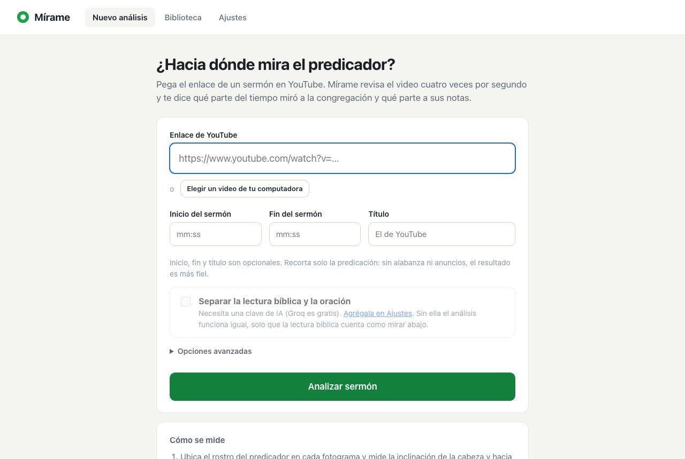

# Mírame

**¿Hacia dónde mira el predicador?** Mírame toma el video de un sermón y mide, segundo a segundo, cuánto tiempo el predicador mira a la congregación y cuánto baja la vista a sus notas. Corre en tu computadora, sin cuentas ni suscripciones.

<p>
  
  
</p>

*A la izquierda, el predicador baja la vista a sus notas (recuadro naranja). A la derecha, mira a la congregación (recuadro verde).*

Lo hice porque quería mejorar como predicador y me di cuenta de que, si no medía, solo iba a seguir suponiendo. No encontré una herramienta que contara cuántas veces uno baja la mirada al predicar, así que la construí con ayuda de un modelo de IA. Es de código abierto: úsala, compártela y mejórala.

— Jacobis Aldana

---

## Qué te dice

- **Qué porcentaje del sermón** miraste a la congregación, cuánto a tus notas y cuánto a la Biblia.
- **Cuánto dura cada mirada** a la gente en promedio, y cuál fue la más larga.
- **Cuántas veces bajaste a las notas** y cuál fue la lectura más larga.
- **Cuánto puede variar el resultado:** el margen de error del porcentaje, para saber si la diferencia entre dos sermones es real.
- **Un reporte** con el video del sermón y, al lado, una línea de tiempo que se pinta de verde (congregación), naranja (notas) o azul (Biblia). Un clic en cualquier punto lleva el video a ese momento.
- **Capturas PNG** de 1920×1080 listas para un artículo o una presentación.

## Cómo lo mide

1. Revisa el video **cuatro veces por segundo**. En cada cuadro ubica el rostro del predicador con [MediaPipe](https://ai.google.dev/edge/mediapipe/solutions/vision/face_landmarker) y mide dos cosas: cuánto inclina la cabeza y hacia dónde apuntan los ojos. Se puede leer con la cabeza recta, moviendo solo la mirada, y eso también cuenta.
2. Aprende la **postura habitual** del predicador cuando mira a la gente, a partir de los momentos en que tiene los ojos arriba. Marca como «abajo» lo que pasa de unos 15° por debajo de esa postura, o cuando los ojos se bajan al menos medio segundo aunque la cabeza no se mueva. Cerca del límite deciden los ojos, y los parpadeos no cuentan.
3. Agrupa por segundo y calcula los porcentajes, las miradas, los episodios de lectura y el margen de error.
4. **Opcional, con IA:** transcribe el audio y un modelo de lenguaje marca dónde se lee la Biblia y dónde se ora. Así, leer el texto bíblico no cuenta igual que leer el manuscrito, y cerrar los ojos al orar no se confunde con mirar abajo.

El detalle del método, sus límites y cómo validarlo están en [docs/como-funciona.md](docs/como-funciona.md).

**Tu video no sale de tu computadora.** Todo el análisis de imagen es local. Si activas la IA, lo único que se envía es el audio (al servicio de transcripción) y el texto transcrito (al modelo que marca las lecturas).

---

## Instalación

Necesitas dos programas: **uv**, que instala Mírame y su versión de Python, y **ffmpeg**, que lee y recorta el video. Se instalan una sola vez.

### macOS

Abre la app **Terminal** y pega, una por una:

```bash
# 1. Homebrew (si no lo tienes): https://brew.sh
/bin/bash -c "$(curl -fsSL https://raw.githubusercontent.com/Homebrew/install/HEAD/install.sh)"

# 2. ffmpeg y uv
brew install ffmpeg uv

# 3. Mírame
uv tool install "mirame[capturas] @ git+https://github.com/jacomv/mirame"
mirame instalar-capturas
```

### Windows

Abre **PowerShell** y pega, una por una:

```powershell
winget install --id Gyan.FFmpeg
winget install --id astral-sh.uv
# Cierra y vuelve a abrir PowerShell para que reconozca los comandos nuevos.
uv tool install "mirame[capturas] @ git+https://github.com/jacomv/mirame"
mirame instalar-capturas
```

### Linux (Debian, Ubuntu)

```bash
sudo apt install ffmpeg
curl -LsSf https://astral.sh/uv/install.sh | sh
uv tool install "mirame[capturas] @ git+https://github.com/jacomv/mirame"
mirame instalar-capturas
```

`mirame instalar-capturas` descarga el navegador que usa el botón **Capturar** (unos 150 MB). Si no te interesan las capturas, instala sin `[capturas]` y omite ese paso: lo demás funciona igual.

La primera vez que analices un sermón, Mírame descarga el modelo de MediaPipe (3,6 MB).

### Actualizar

Para pasar a la última versión, cierra la app (`Ctrl+C` en la terminal donde corre) y ejecuta:

```bash
uv tool upgrade mirame
```

Comprueba la versión instalada con `mirame --version`; también aparece en el pie de la app. Las versiones publicadas y sus cambios están en [Releases](https://github.com/jacomv/mirame/releases) y en el [CHANGELOG](CHANGELOG.md).

Tus análisis, videos y claves viven en `~/Mirame` y no se tocan al actualizar. Si una versión cambia el **método de medición** (el CHANGELOG lo indica), los análisis anteriores conservan sus cifras viejas hasta que los recalcules. Recalcular no vuelve a procesar el video y tarda unos segundos:

```bash
mirame lista                       # ver los análisis guardados y su id
mirame recalcular <análisis>       # aplicar el método nuevo a uno
```

Para instalar una versión concreta, por ejemplo para repetir un análisis con el método de entonces:

```bash
uv tool install --force "mirame[capturas] @ git+https://github.com/jacomv/mirame@v0.4.0"
```

Si trabajas desde el código fuente:

```bash
git pull
uv sync --extra capturas --group dev
```

### Desinstalar

```bash
uv tool uninstall mirame      # tus análisis quedan en ~/Mirame; bórrala a mano si ya no la quieres
```

---

## Uso

### La app

```bash
mirame
```

Se abre en tu navegador, en `http://127.0.0.1:8710`. Solo tu computadora puede verla. Para cerrarla, vuelve a la terminal y presiona `Ctrl+C`.



**Nuevo análisis.** Pega el enlace de YouTube o elige un video de tu computadora. Aparece el video con su título y duración, y eliges qué analizar:

- **Todo el video**, si es solo la predicación.
- **Solo un tramo**, si incluye alabanza, anuncios u oración final. Reproduce el video, páusalo donde empieza la predicación y pulsa **Marcar aquí**; haz lo mismo con el final. También puedes mover las manijas de la barra o escribir los tiempos (`mm:ss` o `h:mm:ss`).

Antes de empezar, Mírame te dice cuánto tardará en tu computadora y te avisa si conviene recortar o si el tramo es demasiado corto. Mientras procesa, en **Biblioteca** ves el avance por etapas y cuánto falta. Como referencia, en un Mac mini con chip de Apple un sermón de una hora tarda unos 3 minutos.

**Biblioteca.** Los análisis guardados, con sus cifras principales. Desde aquí abres el reporte, separas la lectura bíblica de un análisis viejo o lo borras. Abajo puedes vaciar la caché de videos descargados para liberar espacio; tus análisis no se tocan.

**Ajustes.** Las claves de IA. Son opcionales (ver abajo).

**En el reporte:** espacio reproduce y pausa, ← y → saltan 5 segundos, `R` cambia a la vista de resumen sin video. **Capturar** guarda un PNG del momento actual en la carpeta `capturas/` del análisis.

### Claves de IA (opcional)

> **Mírame funciona sin claves de IA.** Si agregas una clave de transcripción (Whisper), el resultado es más fino.

Con una clave, Mírame agrega un paso: transcribe el sermón y separa la lectura bíblica y la oración. Leer la Biblia en voz alta deja de contar como leer notas, y orar con los ojos cerrados deja de contar como mirar abajo. Son dos pasos, y cada uno puede usar un proveedor distinto:

| Paso | Recomendado | Alternativas |
|---|---|---|
| **1. Transcripción** (Whisper: audio a texto con tiempos) | [Groq](https://console.groq.com/keys), gratis: `whisper-large-v3-turbo` | OpenAI (`whisper-1`) o cualquier servicio de Whisper compatible con OpenAI |
| **2. Análisis de la transcripción** (marcar lecturas y oraciones) | Groq con la misma clave: `openai/gpt-oss-120b` | OpenAI, OpenRouter, Azure, DeepSeek, un LiteLLM propio u Ollama en tu máquina |

La forma más simple es una sola clave de **Groq**: créala en [console.groq.com/keys](https://console.groq.com/keys) y pégala en **Ajustes**, y cubre los dos pasos. Para el paso 2 conviene un modelo rápido y sin razonamiento, porque la tarea es marcar frases.

Las claves se guardan en `~/Mirame/configuracion.json`, con permisos de lectura solo para tu usuario. También puedes darlas como variables de entorno, que tienen prioridad sobre el archivo:

| Variable | Para qué |
|---|---|
| `GROQ_API_KEY` | Transcripción y, si no defines otro, el modelo de lecturas |
| `MIRAME_WHISPER_URL`, `MIRAME_WHISPER_KEY`, `MIRAME_WHISPER_MODELO` | Otro servicio de Whisper compatible con OpenAI (p. ej. `https://api.openai.com/v1`, `whisper-1`) |
| `MIRAME_LLM_URL`, `MIRAME_LLM_KEY`, `MIRAME_LLM_MODELO` | Otro modelo compatible con OpenAI para marcar lecturas (URL terminada en `/v1`) |
| `MIRAME_DATOS` | Otra carpeta de datos en lugar de `~/Mirame` |

### Desde la terminal

Todo lo que hace la app también se puede hacer con comandos. Donde dice `<análisis>` va el id que muestra `mirame lista` o la ruta de su carpeta.

```bash
# Analizar solo la predicación (de 32:10 a 1:18:40)
mirame analizar "https://www.youtube.com/watch?v=XXXX" --inicio 32:10 --fin 1:18:40

# Ver los análisis guardados y abrir uno
mirame lista
mirame ver <análisis>

# Separar la lectura bíblica y la oración (requiere clave de IA)
mirame lecturas <análisis>

# Capturas PNG: cuatro momentos elegidos solos, o los que digas
mirame capturar <análisis>
mirame capturar <análisis> --en 19:32 --en 41:45 --resumen

# Ajustar sin volver a procesar el video
mirame recalcular <análisis> --umbral 18             # más o menos estricto con la cabeza
mirame recalcular <análisis> --calibrar 0:00-3:00    # postura habitual tomada de esos minutos
mirame recalcular <análisis> --excluir 5:10-6:40     # dejar fuera un tramo

# Revisar a ojo: 20 fotogramas al azar de cada clase, con el ángulo dibujado
mirame muestras <análisis>

# Comparar con un etiquetado tuyo, segundo a segundo
mirame validar <análisis> etiquetas.csv

mirame borrar <análisis>
mirame --help                                         # todas las opciones
```

---

## Dónde quedan tus datos

Todo vive en `~/Mirame` (en Windows, `C:\Users\<tu usuario>\Mirame`):

```
~/Mirame/
├── analisis/<fecha>_<id>/
│   ├── reporte.html          el reporte; se abre sin conexión y se puede compartir
│   ├── video.mp4             el sermón recortado
│   ├── resumen.json          las cifras del análisis
│   ├── segundos.csv          una fila por segundo: clase, inclinación, ojos
│   ├── fotogramas.csv        una fila por fotograma (4 por segundo)
│   ├── transcripcion.json    si usaste IA: frases con su tiempo
│   ├── lecturas.json         si usaste IA: tramos de lectura bíblica y oración (editable)
│   └── capturas/             los PNG
├── descargas/                caché de videos completos de YouTube
├── modelos/                  modelo de MediaPipe
└── configuracion.json        claves de IA
```

Si la IA marcó mal una lectura, puedes corregir `lecturas.json` a mano y aplicar el cambio con `mirame lecturas <análisis> --solo-recalcular`.

---

## Problemas comunes

**«No encuentro ffmpeg».** Instálalo (ver Instalación) y vuelve a abrir la terminal.

**YouTube no deja descargar** («Sign in to confirm you're not a bot» o un error 403). YouTube cambia seguido. Actualiza con `uv tool upgrade mirame`. Si sigue fallando, instala [Deno](https://deno.com), que yt-dlp usa para algunos videos, o descarga el video por tu cuenta y elígelo como archivo en la app.

**«Sin dato» en buena parte del sermón.** La cámara no muestra la cara del predicador (planos lejanos, la congregación, diapositivas). Esos segundos no cuentan en los porcentajes. Si pasan del 30 %, el reporte avisa que el resultado es poco confiable.

**Las capturas no funcionan.** Corre `mirame instalar-capturas`. Si instalaste sin `[capturas]`, reinstala con el comando de la sección de instalación.

**El puerto 8710 está ocupado.** Mírame prueba solo los siguientes, o usa `mirame app --puerto 9000`.

---

## Contribuir

Las contribuciones son bienvenidas: errores, mejoras de la app y, sobre todo, mejoras del método con evidencia. El flujo de trabajo (ramas, pull requests, versiones y publicaciones) está en [CONTRIBUTING.md](CONTRIBUTING.md). Participar implica aceptar el [código de conducta](CODE_OF_CONDUCT.md). Las vulnerabilidades se reportan en privado (ver [SECURITY.md](SECURITY.md)).

```bash
git clone https://github.com/jacomv/mirame && cd mirame
uv sync --extra capturas --group dev
uv run mirame instalar-capturas
uv run mirame                 # la app con tu código
uv run pytest                 # pruebas
uv run ruff check src tests   # estilo
```

Los cambios de cada versión están en el [CHANGELOG](CHANGELOG.md).

## Licencia

[MIT](LICENSE) © 2026 Jacobis Aldana. Puedes usarlo, modificarlo y distribuirlo, también con fines comerciales, siempre que conserves el aviso de copyright y la licencia en las copias.

Incluye [Chart.js](https://www.chartjs.org) (MIT) para las gráficas del reporte.
